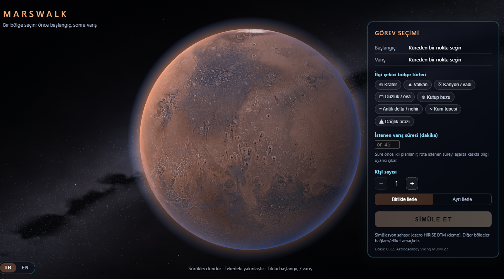
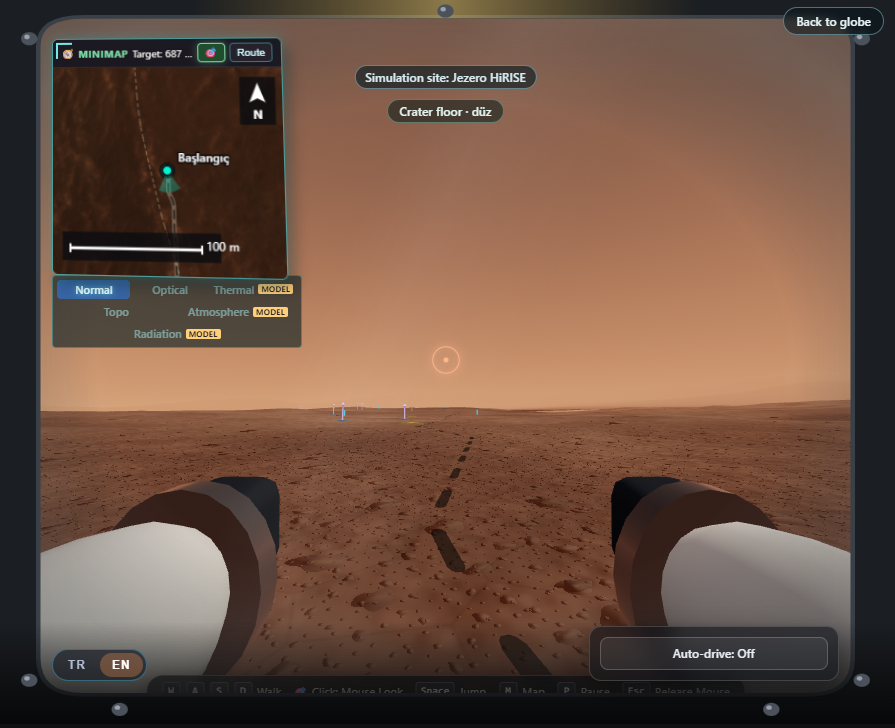

<div align="center">

# Marswalk — Interplanetary Survival Guide: Martian Map

*User-controlled Mars exploration and EVA route-planning simulation over NASA/USGS Jezero Crater terrain — built with zero runtime dependencies.*

[](https://emanzbey48.github.io/EA-Mars/)
[](#overview--genel-bak%C4%B1%C5%9F)
[-2ea44f?style=flat-square)](#architecture--module-map)
[](#key-features)
[](#quick-start-local-run--tests)
[](#quick-start-local-run--tests)
[-6f42c1?style=flat-square)](#one-click--static-deployment)

**🚀 Live Demo / Canlı Simülasyon:** [https://emanzbey48.github.io/EA-Mars/](https://emanzbey48.github.io/EA-Mars/)  
**Presets:** [English (`?lang=en`)](https://emanzbey48.github.io/EA-Mars/?lang=en) · [Jury Demo (`?demo=1`)](https://emanzbey48.github.io/EA-Mars/?demo=1) · [Direct 3D (`?view=3d`)](https://emanzbey48.github.io/EA-Mars/?view=3d) · [Showreel (`?showreel=1`)](https://emanzbey48.github.io/EA-Mars/?showreel=1)

</div>

> **Scope Notice:** Marswalk is an educational exploration and EVA planning simulation. It is **not** a Mars physics engine, live NASA telemetry feed, rover command tool, or certified safe-route system.

---

## Visual Showcase



*1. **Interactive 3D Mars Globe & Mission Setup** — Full-screen 3D Mars globe textured with the USGS Astrogeology Viking MDIM 2.1 mosaic over a procedural Milky Way dust band and starfield backdrop, paired with the glassmorphic right-hand `GÖREV SEÇİMİ` (Mission Selection) panel, bottom-left `TR | EN` language switcher, and interaction hint bar (`Sürükle: döndür · Tekerlek: yakınlaştır · Tıkla: başlangıç / varış`).*

| 2. First-Person Helmet Visor & Jezero HiRISE Terrain | 3. Expanded Holographic Topographic Minimap (`M` / `Topo`) |
|---|---|
|  |  |
| First-person helmet visor over Jezero HiRISE ~1 m regolith and pebble terrain with astronaut forearm view-model, dashed route guide toward distant 3D waypoint beacons, top-center `Simulation site: Jezero HiRISE` + `Crater floor · düz` biome chip, top-left holographic radar minimap with 6 view-mode buttons (`Normal`, `Optical`, `Thermal [MODEL]`, `Topo`, `Atmosphere [MODEL]`, `Radiation [MODEL]`), `TR | EN` switcher, and `Auto-drive: Off`. | Expanded 75% viewport holographic minimap (`M` toggle) in `Topo` mode displaying 2 m contour lines derived from real HiRISE DTM elevation (`Kontur aralığı 2 m (her 5. çizgi kalın)`, no-data cells excluded), route path (`Hedef: 687 m`), and the 6 view-mode selector tabs. |

---

## Overview / Genel Bakış

### English
**Marswalk** is a browser-based exploration and EVA route-planning simulation created for the **NASA Space Apps Challenge 2026** (*Interplanetary Survival Guide: Martian Map*). Built entirely with zero-dependency vanilla ES modules, WebGL2, and Canvas 2D, it lets users inspect Mars on an interactive 3D globe, plan A* walkability routes between historical Perseverance waypoints (**Sol 120 / WB1** and **Sol 164 / Roubion**, ~687 m straight line / ~730 m routed), and traverse 1 m HiRISE Digital Terrain Model (DTM) relief in first person under Mars's `3.71 m/s²` surface gravity reference.

### Türkçe
**Marswalk**, **NASA Space Apps Challenge 2026** (*Interplanetary Survival Guide: Martian Map*) için geliştirilmiş, tarayıcı tabanlı bir Mars keşif ve EVA rota planlama simülasyonudur. Hiçbir harici paket bağımlılığı olmadan saf ES modülleri, WebGL2 ve Canvas 2D ile geliştirilmiştir. Kullanıcılar etkileşimli 3B Mars küresi üzerinden görev seçimi yapabilir, tarihsel Perseverance durakları (**Sol 120 / WB1 → Sol 164 / Roubion**, ~687 m kuş uçuşu / ~730 m A* rotası) arasında EVA yürünebilirlik rotaları planlayabilir ve ~1 m çözünürlüklü HiRISE DTM arazisinde Mars'ın `3,71 m/s²` yüzey yerçekimi referansı altında birinci şahıs yürüyüş deneyimi yaşayabilir.

---

## Key Features

### 1. Interactive 3D Mars Globe & Bilingual Flow
- **Global Context (`view/globe/`):** Textured with a **USGS Astrogeology Viking MDIM 2.1** color mosaic tile pyramid (`z0`–`z3`, 232 m/px), with a deterministic procedural fallback texture if tiles fail to load.
- **Spin & Space Backdrop:** Smooth `5 s/turn` auto-spin (`AUTO_SPIN_SECONDS_PER_TURN = 5`) that pauses during pointer drag and eases back smoothly ~0.5 s after release, over a procedural Milky Way galactic dust band (`makeGalaxyPixels(1024, 512)`) and `3,200` stars (`makeStarField(3200)`) with parallax and reduced-motion support.
- **Region & Point Picking:** Hover inspection across 18 named Martian regions (8 terrain categories) and free-click start/destination picking with a great-circle visual arc (for context only, not a global route).
- **Mission Setup Panel & Fallback:** Glassmorphic right-hand mission setup panel (desired arrival time in minutes, crew size 1–4, together/split progression) and automatic WebGL fallback directly to the local simulation if WebGL is unavailable.
- **Bilingual Interface (`TR | EN`):** Bottom-left `TR | EN` toggle switch (`app/lang-switch.js`) and `?lang=tr|en` URL parameter backed by `app/i18n.js` and `app/i18n-dict.js` (542 translation dictionary entries + 12 inline regex rules with `MutationObserver` DOM updates and `localStorage` persistence).

### 2. Jezero Crater 1 m HiRISE 3D Terrain & 2D Canvas Fallback
- **WebGL2 3D Pipeline (`view/3d/`):** `renderer.js` with procedural micro-grain, pebble, boulder, crater, and aeolian dust mantle shading (`terrain-shading.js`), Mars sky/sun model with ACES filmic tone mapping (`sky-model.js`), sun shadow maps (`shadow-map.js`), regional MOLA horizon silhouette (`horizon-mesh.js`), terrain-sampled footprints (`footprint-trail.js`), 3D waypoint beacons (`marker-mesh.js`), and adaptive quality governor (`?quality=auto|high|medium|low|minimal`).
- **HiRISE 25 cm WMTS Orthomosaic Overlay:** `z17` (0.318 m/px) and `z14` (2.544 m/px) tiles supporting `Hybrid`, `Ortho`, and `Hillshade` modes.
- **2D Canvas Fallback (`view/render.js`):** Complete 2D rendering pipeline preserving all layers, route planning, and controls when WebGL2 is unavailable or 2D is chosen.

### 3. Mars `3.71 m/s²` Ballistics & Stage 13 EVA Loping Kinematics
- **Stage 12 Ballistics & Camera Dynamics (`sim.js`, `camera.js`, `camera-motion.js`):** `3.71 m/s²` Mars gravity reference, `2.4 m/s` game hop impulse (~1.29 s scenario flight time, ~0.78 m apex; presented at `2×` airborne time rate so each hop reads ~0.6 s wall-clock without altering physics), airborne horizontal momentum conservation, `0.25 s` landing impact absorption (`landingRecovery`), step head-bobbing, and landing camera dip (~0.055 m).
- **Stage 13 Rig Kinematics (`astronaut-rig.js`):** Deterministic pose synthesis from movement snapshot fields (`timeS`, `horizontalSpeedMps`, `verticalSpeedMps`, `grounded`, `airborne`, `phase`, `landingRecovery`, `landingRecoveryFrac`), implementing Froude-scaled EVA loping gait, three-stage flight poses (ascent, apex balance, descent brace), landing squash & recover, and camera-attached first-person gloves/forearms with `0.25 Hz` wall-clock breathing and progressive look-down torso/leg reveal.

### 4. A* EVA Walkability Route Planner (`Sim/public/js/route/`)
- **Worker Pathfinding:** Web Worker A* pathfinder (`pathfinder.worker.js`) scoring 3×3 Horn slope, plane-residual roughness, and cell validity (`cost-model.js`).
- **Route Preferences & Stale Guard:** Three selectable route preferences (`Balanced`, `Shortest`, `Flattest` in `route-compare.js`) with stale-plan protection (`plan-response-state.js`).
- **K3-10 Regular Local Grid Alignment (`legacy-grid-plan.js`):** Resamples the legacy coordinate-bridged DTM once into a regular `1670×1170` local-meter grid (`1.00966 m/px`, `nearest`) so planner, heatmap, minimap, and 3D terrain sampler agree on exact cell elevations.

### 5. Helmet Visor, Holographic Minimap, Auto-Drive, Crew & Showreel
- **Helmet Visor (`view/helmet.js`):** SVG frame with gold highlight, vignette, glare, subtle ~4 s breath-fog cycle, and planning-indicator warning chips (no fabricated O₂ or suit temperature telemetry).
- **Holographic Minimap (`view/minimap/`):** Top-left HUD radar expandable to 75% viewport via `M`; includes **6 visible view modes** (`Normal`, `Optic` [DTM hillshade], `Topo` [Marching-squares DTM contours], plus clearly labeled scenario models `Thermal`, `Atmosphere`, `Radiation`; `Geophysical` and `Chemical` remain hidden as unavailable data).
- **Auto-Drive (`simulation/auto-drive.js`):** `0.5×`–`10×` time-rate slider (`0.5` steps), jerk-limited smooth yaw steering & corner deceleration along Chaikin-smoothed paths, and a **20 m rejoin rule** (`rejoinThresholdM = 20`: rejoins if within 20 m of the route, otherwise re-plans from current position).
- **Crew Strip (`crew-sim.js`, `crew-strip.js`):** 2–4 crew companions rendered on the 2D minimap with remaining distance readout.
- **Biome Chip (`biome-label.js`, `biome-chip.js`):** Displays a heuristic plain-language label derived from the active USGS SIM 3464 geologic unit and local slope (hidden when unmapped).
- **Autopilot Showreel (`app/showreel.js`):** Activated via `?showreel=1` or pressing `R` on the globe screen.

---

## Scientific Honesty & Scope Boundaries

Marswalk separates **measured data**, **computed derivatives**, **scenario parameters**, and **presentation choices** across both UI labels and documentation ([`Sim/DEMO_NOTES.md`](Sim/DEMO_NOTES.md), [`Sim/SOURCES.md`](Sim/SOURCES.md)):

1. **EVA Walkability Is a Planning Indicator, Not a Safety Certificate:** Walkability scores (`0–100`), the `20°` hard slope limit, route preference weights (`route-compare.js`), and the `±10 m` route corridor (`config.js`) are **scenario parameters** — never a NASA operational threshold, rover trafficability limit, or safe-route certification.
2. **Active Rendered Terrain vs. USGS Candidate:** The UI currently renders the **legacy PDS3 HiRISE DTM** (`DTEEC_045994_1985_046060_1985_U01`, `1669×1129`, `~1.0097 m/px`) via fail-closed fallback in `surface/registry.js`. The newer **USGS Mars 2020 TRN 1 m DTM candidate** (`JEZ_hirise_soc_006_DTM_MOLAtopography_DeltaGeoid_1m_Eqc_latTs0_lon0_blend40`, `1676×1135`, CC0 1.0) remains flagged `needs_review` (`needs_review_verticalReference`) and is held out of display until product-specific vertical datum evidence is verified.
3. **Strict No-Data Integrity (`0xFF7FFFFB`):** Cells matching `0xFF7FFFFB` (`no_data`), out-of-bounds areas, or invalid values are **never coerced to `0`**, **never produce a 3×3 Horn slope**, **never receive contour lines**, and **never bridge triangles** across voids in 3D terrain meshes.
4. **Gravity & Atmospheric Limits:** Vertical jump ballistics uses NASA Planet Compare's rounded surface gravity (`3.71 m/s²`; NSSDC gives `3.73 m/s²`). Atmospheric pressure/density figures (NSSDC `6.36 mbar` mean, `4.0–8.7 mbar` seasonal, `~0.016 ± 0.006 kg/m³`) are contextual references only; **no atmospheric drag or suit/body biomechanics** is fabricated in character movement.
5. **Imagery, Traverse & Globe Scope:**
   - No JPEG 2000 decoder is included for `ESP_046060_1985_RED_C_01_ORTHO.JP2`; DTM-derived hillshade is never labeled as orthoimagery.
   - HiRISE WMTS ortho overlay alignment (`±1.5 m` measured on the USGS candidate) is unverified on the active legacy DTM; half-pixel alignment is not claimed.
   - Globe region selections and free clicks outside the valid Jezero HiRISE patch are **context/label selections only** — simulation always runs on the Jezero HiRISE DTM patch.
   - The Sol 120 → Sol 164 connection is a simplified waypoint link + A* path (**PDS PLACES** was not used); the MMGIS rover track is historical archive data; USGS SIM 3464 geology (`1:75,000`) carries `~100–200 m` positional uncertainty; and 13 of 14 sources in `Sim/SOURCES.md` state no explicit license (`belirtilmemiş`).

---

## Quick Start (Local Run & Tests)

### Requirements
- **Node.js ≥ 20** for the local dev server and unit tests (`node --test`).
- **Node.js ≥ 22** + local **Edge or Chrome** only if running the optional headless E2E smoke script (`npm run smoke`).
- **Zero npm installs** required. The ~7.5–7.6 MB `.f32` terrain files are committed as plain Git blobs (commit `5c8090c`), so cloning without `git-lfs` provides all runtime data out of the box. *(Raw `.IMG`/`.JP2` files outside `Sim/` are only needed if regenerating DTM subsets via `npm run prepare-data`.)*

### Run & Verify

```bash
cd Sim
node scripts/preflight.mjs   # Verify Node version, binary files, and SHA-256 manifests (expect HAZIR / READY)
npm start                    # Starts local static server at http://127.0.0.1:8080/ (override with PORT=...)
npm test                     # Runs node:test unit test suite in Sim/test/
npm run smoke                # Optional: headless Edge/Chrome E2E check -> writes screenshots to Sim/test-output/
```

### Quick Local Entry URLs

| URL | Mode |
|---|---|
| `http://127.0.0.1:8080/` | Default Mars globe intro & mission flow |
| `http://127.0.0.1:8080/?lang=en` | Start directly in English |
| `http://127.0.0.1:8080/?demo=1` | Presentation & Jury Demo Mode (auto-prepares Sol 120 → Sol 164) |
| `http://127.0.0.1:8080/?view=3d` | Direct 3D first-person Jezero exploration |

---

## One-Click / Static Deployment

Marswalk builds into a 100% self-contained static site (`Sim/dist/`) with subpath-relative URLs so it deploys cleanly on both root domains and `/<repo-name>/` project subpaths:

```bash
cd Sim
node scripts/preflight.mjs
npm run build:pages          # Outputs static site bundle into Sim/dist/
```

| Platform | Configuration / Command |
|---|---|
| **GitHub Pages** | [`.github/workflows/deploy-pages.yml`](.github/workflows/deploy-pages.yml) (enable **Settings → Pages → Source: GitHub Actions**) |
| **Cloudflare Pages** | `npx wrangler pages deploy dist --project-name=marswalk` (or GitHub Actions with `CLOUDFLARE_PAGES_PROJECT`, `CLOUDFLARE_API_TOKEN`, `CLOUDFLARE_ACCOUNT_ID`) |
| **Netlify** | Root [`netlify.toml`](netlify.toml) (`base = "Sim"`, `command = "npm run build:pages"`, `publish = "dist"`) |
| **Vercel** | Root [`vercel.json`](vercel.json) |

Full deployment instructions and preview steps are in [`Sim/DEPLOYMENT.md`](Sim/DEPLOYMENT.md).

---

## Architecture & Module Map

The frontend inside `Sim/public/js/` follows strict unidirectional boundaries with explicit parameter-based dependency injection (no mutable global state singleton):

| Layer / Directory | Primary Files | Responsibility & Boundary |
|---|---|---|
| **Bootstrap** | `Sim/public/js/main.js` | Composition root: resolves surface providers, steps simulation, builds one deeply frozen `WorldSnapshot` per frame, wires HUD and renderers. |
| **Shared Constants** | `Sim/public/js/config.js` | Read-only `SCENARIO`, historical `WAYPOINTS`, `MAP_FRAME`, `SOURCES`, `ORTHO_MOSAIC_SOURCES`. |
| **Geometry & Math** | `Sim/public/js/geo/` | Pure transforms & spatial helpers (`geo.js`, `local-grid.js`, `mars-sun.js`, `geology.js`, `geology-registry.js`, `traverse.js`, `rover-observations.js`, `regional-dem.js`, `relief-metrics.js`, `viking-mosaic.js`, `trek-raster.js`, `trek-tiles.js`, `smooth-path.js`). No DOM or state. |
| **Surface Data** | `Sim/public/js/surface/` | Raster sampling, `STATUS` codes, manifest validation & fail-closed provider selection (`layers.js`, `registry.js`, `ortho-layer.js`, `thermal.js`). |
| **Simulation Core** | `Sim/public/js/simulation/` | `MarswalkSim` physics/clock/snapshot (`sim.js`), auto-drive steering (`auto-drive.js`), 2D crew companions (`crew-sim.js`), path smoothing (`path-smooth-local.js`). No DOM or network. |
| **Route Planning** | `Sim/public/js/route/` | EVA walkability cost model (`cost-model.js`), A* search (`pathfinder.js`, `pathfinder.worker.js`, `route-service.js`), preferences (`route-compare.js`), stale-plan guard (`plan-response-state.js`), K3-10 regular grid (`legacy-grid-plan.js`). |
| **Input** | `Sim/public/js/input/input.js` | Keyboard, pointer-lock mouse look, wheel zoom, and button bindings delegated via callbacks. |
| **App Flows & i18n** | `Sim/public/js/app/` | Globe-to-3D flow (`demo-flow.js`), free-start patch resolver (`free-start.js`), biome labeler (`biome-label.js`), showreel (`showreel.js`), TR/EN dictionary & DOM switcher (`i18n.js`, `i18n-dict.js`, `lang-switch.js`). |
| **2D / HUD Views** | `Sim/public/js/view/` | Canvas 2D renderer (`render.js`), DOM telemetry HUD (`hud.js`), helmet visor (`helmet.js`), auto-drive controls (`auto-drive-controls.js`), crew strip (`crew-strip.js`), biome chip (`biome-chip.js`), rover gallery (`rover-gallery.js`), route guidance (`route-guidance.js`), archive track (`traverse-layer.js`). |
| **3D WebGL2 Pipeline** | `Sim/public/js/view/3d/` | `renderer.js`, `camera.js`, `camera-motion.js`, `terrain-mesh.js`, `astronaut-rig.js`, `marker-mesh.js`, `footprint-trail.js`, `route-ribbon.js`, `horizon-mesh.js`, `shadow-map.js`, `sky-model.js`, `terrain-shading.js`, `quality-governor.js`. |
| **Globe & Minimap** | `Sim/public/js/view/globe/`, `Sim/public/js/view/minimap/` | 3D Mars globe intro (`globe.js`, `index.js`, `globe-panel.js`, `regions.js`, `free-point.js`, `crew-split.js`) and holographic minimap with 6 view modes (`minimap.js`, `view-modes.js`, `view-mode-bar.js`). |
| **Build & QA Scripts** | `Sim/scripts/` | `preflight.mjs`, `build-pages.mjs`, `smoke-e2e.mjs`, `extract-dtm.mjs`, `build-sources-list.mjs`, `ingest-viking-mosaic.mjs`, `fetch-regional-dem.mjs`, validation scripts. |

### WebGL2 Render Pass Contract (`Sim/public/js/view/3d/renderer.js`)

The 3D renderer enforces explicit `uRenderPass` identifiers (`0`–`7`; future passes must use `8+`):

| `uRenderPass` | Pass & Responsibility |
|---|---|
| `0` | Terrain mesh (DTM elevation, procedural micro-detail/dust shading, ortho/hillshade mix, sun shadows) |
| `1` | Guides, lines, and 3D waypoint beacons (emissive) |
| `2` | Astronaut world rig & first-person view-model (material-lit) |
| `3` | Mars sky dome (`sky-model.js`) |
| `4` | Sun shadow depth map pass (early return) |
| `5` | Terrain-sampled footprint decals (lit, non-emissive) |
| `6` | Planned route guide line / ribbon |
| `7` | Distant regional-context MOLA horizon (`horizon-mesh.js`; separate projection, aerial haze, no shadows) |

---

## Keyboard Controls & URL Parameters

### Controls
| Input | 2D Map View | 3D First-Person View | Globe Intro Screen |
|---|---|---|---|
| `W` `A` `S` `D` / Arrow keys | Move on local meter plane | Walk relative to camera yaw | Blocked from sim |
| `Space` | Pause / resume | Small Mars hop (`2.4 m/s` impulse) | Blocked from sim |
| `P` | Pause / resume | Pause / resume | Blocked from sim |
| Click canvas + Mouse move | — | Request pointer-lock mouse look | Drag to rotate globe; click to pick start / end |
| `Esc` | Close setup / demo mode | Release pointer lock; close modal or shrink expanded map | — |
| `M` | — | Expand / collapse holographic minimap (75% viewport) | — |
| `R` | Restart simulation | Restart simulation (or stop running showreel) | Start / stop showreel autopilot |
| `+` / `-` / Mouse wheel | Zoom map | Zoom / adjust view | Mouse wheel zooms globe |

### URL Parameters
| Parameter | Values | Effect |
|---|---|---|
| `lang` | `tr` (default), `en` | Sets UI language (`lang` query > `localStorage` > `'tr'`). |
| `demo` / `presentation` | `1` | Opens Presentation & Jury Demo Mode and auto-prepares Sol 120 → Sol 164 (skips globe). |
| `view` | `3d` | Opens directly in 3D first-person view (skips globe; stays 2D if DTM/WebGL2 unavailable). |
| `scale` | `1` (default), `2`, `3` | Vertical exaggeration (`1` = true 1:1 elevation; `2`/`3` = labeled visual exaggeration). |
| `shadows` | `off`, `low`, `high` (default) | Pins sun shadow-map preset (`0` / `1024 px` / `2048 px`). |
| `horizon` | `off` | Disables the regional MOLA horizon pass; all other values leave it enabled. |
| `quality` | `auto` (default), `high`, `medium`, `low`, `minimal` | Pins adaptive quality governor level. |
| `intro` | `0` | Disables the Mars globe intro, helmet visor, auto-drive, crew strip, and biome chip (used by `npm run smoke`). |
| `showreel` | `1` | Auto-starts the presentation showreel once the globe screen opens (no effect with `intro=0`). |
| `debug` | `1` | Exposes `window.marswalk` diagnostic handle (development/testing only). |
| `testWebGL2Failure` | `1` *(with `debug=1`)* | Forces WebGL2 initialization failure to test the 2D Canvas fallback. |

---

## Data Sources & Attribution

Primary imagery, elevation, geologic mapping, and mission reference data originate from **NASA / JPL-Caltech / University of Arizona / USGS Astrogeology Science Center**. Full product IDs, resolutions, provenance caveats, and license statuses are maintained in:

- [`Sim/SOURCES.md`](Sim/SOURCES.md) — Complete 14-source inventory generated from dataset manifests
- [`Sim/DEMO_NOTES.md`](Sim/DEMO_NOTES.md) — Jury boundary card & `MEASURED` / `COMPUTED` / `SCENARIO` / `PRESENTATION` table
- [`Sim/README.md`](Sim/README.md) — Detailed technical documentation (Turkish)
- [`Sim/DEPLOYMENT.md`](Sim/DEPLOYMENT.md) — Static packaging & hosting guide (TR / EN)
- [`Sim/stage-final-acceptance.md`](Sim/stage-final-acceptance.md) — Browser acceptance evidence and known limitations
- [`Sim/submission/project-page-en.md`](Sim/submission/project-page-en.md) & [`Sim/submission/README_EN.md`](Sim/submission/README_EN.md) — English submission documentation
